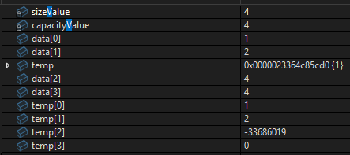

# "모르겠다"에서 시작해 vector를 직접 만들어 봤다

## 궁금했던 것

`std::vector`는 매일 쓰지만 안에서 어떻게 동작하는지 몰랐다. 직접 만들어 보기로 했다.

시작할 때의 내 상태:

> 진짜 솔직히 모르겠어

> 흠 일단 해봤는데 모르겠어 아직도

처음에는 판(배열)을 가리키는 변수의 타입을 `MyVector*`로 썼다. 판에 담기는 건 int라서 `int*`가 맞았다.

## 만든 과정

### 0단계: 판, 계란 수, 판의 칸 수

```cpp
class MyVector
{
private:
    int* data;
    int sizeValue;
    int capacityValue;
    ...
};
```

이 구조를 내 말로 정리하면:

> int의 포인터를 만들어서 int 배열의 주소값을, 배열의 공간이 커질 때마다 새로운 주소를 받아서 다른 메모리 장소로 이동하는 거지.

처음 capacity를 0으로 할지, 미리 잡을지 고민했다. 처음엔 "vector가 0으로 시작한다고 해서" 0으로 맞췄다가, 내 이유로 다시 정했다.

> 불필요한 메모리를 잡지 않기 위해 쓰지 않는 건 미리 할당시키지 않겠어.

```cpp
MyVector::MyVector()
{
	data = nullptr;
	sizeValue = 0;
	capacityValue = 0;
}
```

### 1단계: push_back과 판 늘리기

```cpp
void MyVector::push_back(int InValue)
{
	if (capacityValue == 0)
	{
		capacityValue = 1;
		sizeValue = 1;
		data = new int[capacityValue];
		data[sizeValue - 1] = InValue;
		return;
	}

	if (sizeValue == capacityValue)
	{
		int* temp = data;

		capacityValue *= 2;
		data = new int[capacityValue];
		for (int i = 0; i < sizeValue; i++)
		{
			data[i] = temp[i];
		}

		delete[] temp;
	}

	++sizeValue;
	data[sizeValue - 1] = InValue;
}
```

### 2단계: operator[]

```cpp
int& MyVector::operator[](int Invalue)
{
	assert(Invalue < sizeValue && Invalue >= 0);
	return data[Invalue];
}
```

## 결과

```
after v[2] = 3: size 5, capacity 8, [1, 2, 3, 4, 5]
--- leak check ---
no leaks
v[3] (size 4) = 4
v[4]  → Assertion failed: Invalue < sizeValue && Invalue >=0
v[-1] → Assertion failed: Invalue < sizeValue && Invalue >=0
```

## 왜 그런가: 만나면서 고친 버그 넷

### 버그 1: 값이 안 들어간다

처음 진단:

> temp에서 첫 번째 값만 기억하고 있다는 거야. 그래서 이전할 그다음 값들을 잃어버리더라.

이건 디버거가 `int*`를 첫 칸만 보여 줘서 생긴 착각이었다. 다시 보니 패턴이 있었다.

> 1 (2) 4 (4) 괄호 친 데이터들이 안 들어가고 있어.

빠진 값은 모두 판을 늘리는 순간에 넣은 값이었고, 판 늘리기 분기 끝의 `return;` 때문에 새 값을 넣는 줄까지 내려가지 못했다.

### 버그 2: 판을 늘릴 때마다 메모리 누수

처음 코드는 `int* temp = new int[capacityValue];` 다음 줄에서 `temp = data;`를 했다. 누수 검사기에 4, 8, 16바이트짜리 한 번도 안 쓴 메모리가 남았다.

> 포인터에 다른 주소를 넣으니 원래 주소는 그 주소를 찾을 수 있는 포인터는 사라지고, 원래 빈 new temp는 계속 남아 있는 거지.

> 새 판은 data에서 큰 판으로 만들 때 생기는 거고, temp에 저장되는 건 원래 옛날 판이 맞다는 거.

### 버그 3: 없는 칸에 -1을 돌려줬다

처음엔 없는 칸을 요청하면 -1을 돌려주게 했다. 그런데 `push_back(-1)`을 하면 진짜 -1과 에러 -1을 구분할 수 없었다. 범위 검사도 size가 아니라 capacity와 비교하고 있어서, 배열 밖이나 한 번도 안 쓴 칸을 읽었다.

### 버그 4: assert가 다 걸렸다

> assert 조건을 if랑 똑같이 썼었거든.

`assert(조건)`의 조건은 에러인 경우가 아니라 반드시 참이어야 하는 것이다.

## 정리

일단 처음에 벡터를 만들려면 어떻게 공간에 담아야 하나 막막함이 있었다. 배열에 담아야겠다는 것까지는 알겠는데, 어떻게 선언해야 하고 어떻게 관리하는지 막막하다가, 쪼개서 보니 포인터로 배열이라는 판을 주소로 받아와서 쓰면 된다, 그리고 그 판이 가득 차면 새로운 판에다가 옮기고 관리한다라는 과정을 배우는 게 유익했다.

솔직히 그동안 포인터를 배우고 어떻게 쓰는지 이해가 잘 가지 않았는데, 이번에는 좀 이해를 할 수 있는 과정이었던 것 같다.

또한 push_back 함수를 재현할 때 왜 데이터가 제대로 담기지 않는지에 대해 디버깅을 직접 일일이 변수를 까면서 확인하는 과정을 거치니, 어떻게 디버깅을 하는지에 대해 조금은 알아본 것 같다.


